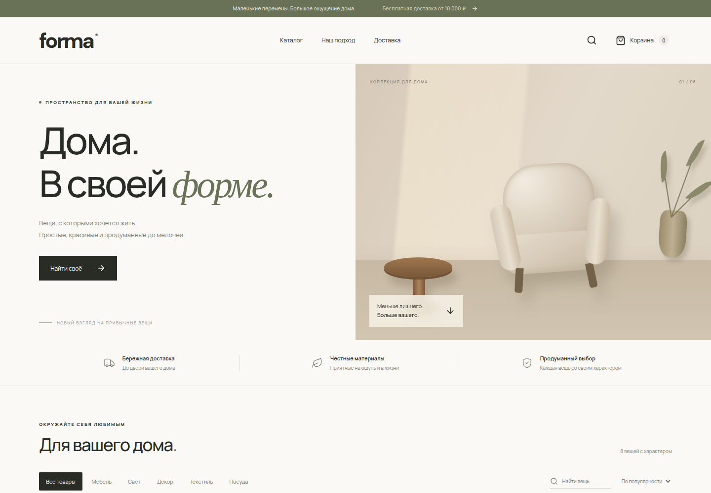

# FORMA — интернет-магазин на TypeScript

Полноценный стартовый магазин товаров для дома: Next.js 16 (App Router, React 19), NestJS 11, Prisma ORM 7 и PostgreSQL **17**. Весь стек запускается через Docker Compose. Интерфейс на русском, адаптирован под телефон и компьютер; иллюстрации хранятся в проекте, внешние сервисы изображений не нужны.

## Возможности

- Каталог из 8 демонстрационных товаров, категории, поиск, сортировка по цене и подробности товара.
- Корзина с изменением количества и сохранением в браузере.
- Оформление заказа: имя, email, телефон, адрес и комментарий.
- Оплата при получении. Суммы хранятся целыми числами в копейках. Доставка 390 ₽, от 10 000 ₽ бесплатно.
- Цены берутся из БД. Сервер проверяет запрос и атомарно списывает остатки, не позволяя продать больше доступного.
- Повторная отправка заказа с тем же `requestId` возвращает ту же квитанцию; изменение содержимого с тем же ID отклоняется.
- Контактные данные сохраняются в БД; публичного API чтения заказов нет. Ответ оформления содержит только квитанцию.
- Health check БД, ограничение частоты запросов, Helmet, миграции, повторяемый seed, автоматические проверки GitHub Actions.



## Быстрый запуск — Docker Compose

Нужны Docker Engine и Compose v2.

```bash
cp .env.example .env
docker compose up --build -d
```

- Магазин: **http://localhost:3100**
- API: **http://localhost:4000/api/products**
- Health check: **http://localhost:4000/api/health**
- PostgreSQL 17: `localhost:5434`

Compose ждёт готовности PostgreSQL, выполняет миграции и seed, запускает API и затем frontend. Seed обновляет описания каталога, сохраняя остатки уже существующих товаров. Данные БД находятся в volume `postgres_data`.

В `.env.example` указаны только локальные демонстрационные реквизиты. Для своего сервера задайте отдельный пароль. В пароле для показанного шаблона подключения используйте символы, допустимые в URL, либо настройте URL с percent-encoding. `.env` и персональные данные в Git не попадают.

```bash
docker compose ps
docker compose logs -f api web
docker compose down
```

`down` сохраняет БД. Команда `docker compose down -v` удаляет данные проекта — используйте только для намеренного сброса.

Если ваш Docker ссылается на отсутствующий `docker-credential-desktop`, исправьте credential helper в локальной настройке Docker или используйте отдельный `DOCKER_CONFIG` без этого helper. Это настройка компьютера, а не проекта.

## Разработка без контейнеров приложений

Нужны Node.js 22.12+ (рекомендуется 24), npm 10.9.6 и PostgreSQL 17. Версия npm закреплена для воспроизводимой установки и применения overrides. Если на компьютере другая версия, запускайте `npx npm@10.9.6 ci` вместо `npm ci`. Docker и CI используют закреплённую версию.

```bash
npm ci
cp .env.example .env
cp apps/api/.env.example apps/api/.env
cp apps/web/.env.example apps/web/.env.local
docker compose up -d db
npm run db:generate
npm run db:migrate
npm run db:seed
```

В двух терминалах:

```bash
npm run dev:api
npm run dev:web
```

Backend читает `apps/api/.env`, frontend — `apps/web/.env.local`; корневой `.env` используется Compose. Для миграций и API в CI можно передать `DATABASE_URL` через окружение. Frontend обращается к NestJS через собственный серверный `/api` proxy: `API_INTERNAL_URL` доступен только серверу Next.js.

## Структура

```text
apps/
  api/
    prisma/           # схема, SQL-миграции, seed
    src/              # NestJS, Prisma, каталог, заказы, DTO
  web/
    app/              # Next.js App Router, интерфейс, API proxy
    public/products/  # локальные SVG-иллюстрации
scripts/integration.mjs
e2e/store.spec.ts
compose.yaml
Dockerfile
.github/workflows/ci.yml
```

## API

| Метод | Адрес                 | Назначение                       |
| ----- | --------------------- | -------------------------------- |
| GET   | `/api/health`         | Готовность API и соединения с БД |
| GET   | `/api/products`       | Каталог                          |
| GET   | `/api/products/:slug` | Подробности товара               |
| POST  | `/api/orders`         | Создание заказа                  |

Пример тела заказа (ID товара возьмите из каталога):

```json
{
  "requestId": "ecfeab41-ab7a-44ae-926d-d007df801f24",
  "customerName": "Иван Иванов",
  "email": "ivan@example.com",
  "phone": "+79990000000",
  "address": "Москва, улица Примерная, дом 1, квартира 2",
  "items": [{ "productId": "UUID-ИЗ-КАТАЛОГА", "quantity": 1 }]
}
```

Дополнительные поля, отрицательное количество и подмена цены отклоняются. Максимум — 20 единиц одного товара и 50 строк. Для нового заказа используйте новый UUID `requestId`; при сетевом сбое повторяйте исходный запрос с прежним ID. HTTP 400 — неверные данные, 409 — недостаточный остаток/недоступный товар/повторное использование ID с другим содержимым, 429 — превышение частоты запросов.

## Проверки

```bash
npm run build
npm run typecheck
npm test
npm run format:check
npx npm@10.9.6 audit
```

Интеграционные и браузерные тесты создают тестовые заказы и расходуют остатки. Запускайте их на отдельной тестовой БД с миграциями и seed.

```bash
# API должен быть запущен:
npm run test:integration
# Другой адрес API:
TEST_API_URL=http://localhost:4000/api npm run test:integration

# После npm run build; Playwright сам запустит приложения при необходимости:
npx playwright install chromium
npm run test:e2e
# Можно использовать установленный Google Chrome:
PLAYWRIGHT_CHROME_PATH=/opt/google/chrome/chrome npm run test:e2e
```

CI собирает обе части, проверяет типы и выполняет unit, интеграционные и браузерные тесты с PostgreSQL 17. Приложения в Docker запускаются от непривилегированного пользователя.

## Границы текущей версии

Это рабочая основа магазина с демонстрационным каталогом и оплатой при получении. Админ-панель, аккаунты покупателей, онлайн-эквайринг, реальные уведомления и интеграция со службой доставки пока не подключены. Тексты о доставке — пример условий для демонстрации; укажите реальные условия перед запуском продаж. Email и SMS автоматически не отправляются.

Для публичного запуска настройте домен/HTTPS, резервное копирование БД, реальные условия доставки и обработку заказов, политику персональных данных. Порты в Compose привязаны к loopback. Ограничитель запросов NestJS хранит счётчики в памяти процесса; за Next.js proxy лимит общий для его исходящего IP. Для нескольких инстансов настройте Redis и доверенные proxy/IP.

Использована официальная документация [Next.js](https://nextjs.org/docs/app/getting-started/installation), [NestJS](https://docs.nestjs.com/techniques/validation) и [Prisma](https://www.prisma.io/docs/orm/prisma-client/setup-and-configuration/introduction).
